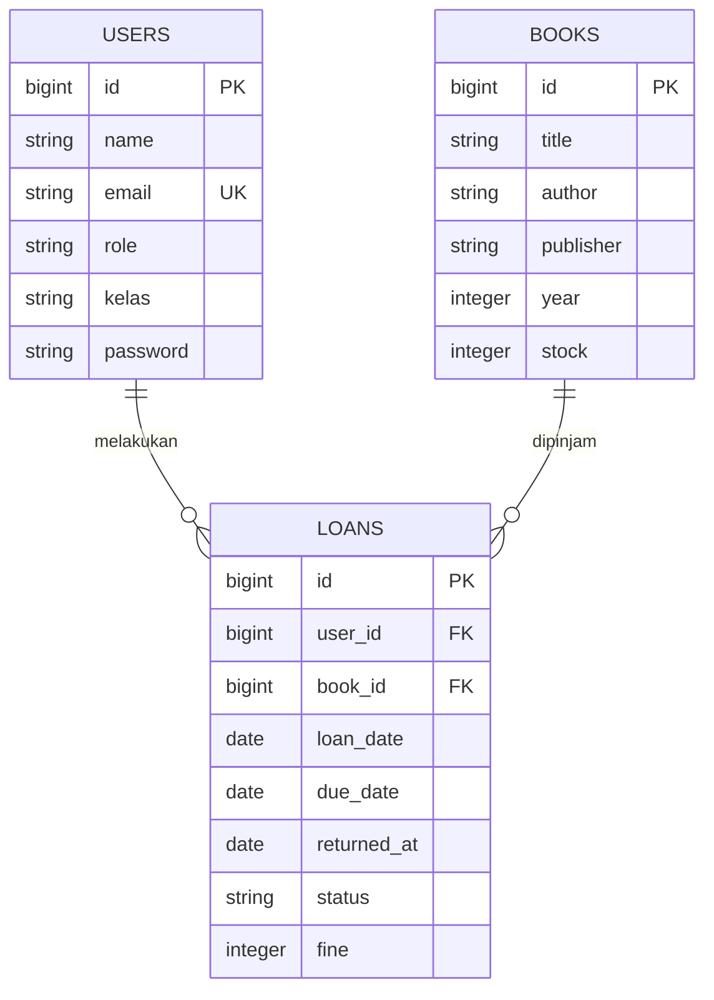

# Aplikasi Peminjaman Buku

Aplikasi web untuk membantu mengelola data buku dan transaksi peminjaman perpustakaan. Panel administrasi dibangun menggunakan Laravel dan Filament.

## Fitur

- Login dan pendaftaran melalui panel Filament.
- Pengelolaan data buku, pengguna, dan peminjaman melalui panel admin.
- Pencatatan tanggal pinjam, jatuh tempo, tanggal pengembalian, status, dan denda.
- Daftar peminjaman siswa dibatasi ke data milik siswa tersebut.
- Contoh akun dan data awal melalui database seeder.

> Aplikasi saat ini berpusat pada panel Filament dan belum memiliki halaman katalog publik terpisah untuk siswa.

## Teknologi

- PHP 8.2 atau lebih baru
- Laravel 12
- Filament 4
- MySQL/MariaDB atau SQLite
- Composer
- Node.js dan npm (untuk membangun aset frontend)

## Instalasi dan menjalankan aplikasi

1. Clone repository dan masuk ke folder proyek:

   ```bash
   git clone https://github.com/USERNAME/NAMA-REPOSITORY.git
   cd NAMA-REPOSITORY
   ```

2. Pasang dependency PHP dan buat file konfigurasi lokal:

   ```bash
   composer install
   ```

   Jika `.env` belum ada, salin `.env.example` menjadi `.env` (PowerShell):

   ```powershell
   Copy-Item .env.example .env
   ```

3. Buat application key:

   ```bash
   php artisan key:generate
   ```

4. Atur koneksi database di `.env`. Contoh untuk MySQL lokal (sesuaikan username, password, dan port dengan Laragon/XAMPP):

   ```dotenv
   DB_CONNECTION=mysql
   DB_HOST=127.0.0.1
   DB_PORT=3306
   DB_DATABASE=peminjaman_buku
   DB_USERNAME=root
   DB_PASSWORD=
   ```

   Buat database `peminjaman_buku` terlebih dahulu dan pastikan layanan MySQL berjalan. Jangan unggah `.env` ke GitHub.

5. Buat tabel dan data contoh:

   ```bash
   php artisan migrate --seed
   ```

   Seeder membuat akun contoh dan beberapa buku. Jalankan pada database baru; menjalankan seeder lagi dapat gagal karena email akun contoh sudah terdaftar.

6. (Opsional) Pasang dan bangun aset frontend:

   ```bash
   npm install
   npm run build
   ```

7. Jalankan server pengembangan:

   ```bash
   php artisan serve
   ```

8. Buka panel di `http://127.0.0.1:8000/admin`.

### Akun contoh

| Peran | Email | Kata sandi |
|---|---|---|
| Admin | `admin@perpus.test` | `password` |
| Siswa | `siswa@perpus.test` | `password` |

Akun ini hanya untuk pengembangan dan pengujian lokal. Ganti kata sandi dan jangan gunakan kredensial contoh di server publik.

## Prosedur penggunaan

1. Login ke `/admin`.
2. Buka menu **Books** untuk menambah atau mengelola data buku.
3. Buka menu **Users** untuk mengelola akun pengguna (admin).
4. Buka menu **Loans** untuk melihat atau mencatat transaksi peminjaman.
5. Isi pengguna, buku, tanggal pinjam, dan tanggal jatuh tempo saat membuat transaksi.
6. Gunakan aksi pengembalian pada transaksi yang masih berstatus `dipinjam`. Sistem menandai transaksi sebagai `dikembalikan` dan menghitung denda Rp1.000 per hari keterlambatan.

## Struktur database (ERD)



`loans.user_id` merujuk ke `users.id`, sedangkan `loans.book_id` merujuk ke `books.id`. Satu pengguna atau buku dapat memiliki banyak catatan peminjaman. Struktur lengkap termasuk tabel pendukung Laravel tersedia di `database/migrations`.

## Database SQL

Migration Laravel merupakan sumber struktur database aplikasi. Untuk membuat dump SQL MySQL/MariaDB setelah database diisi:

```bash
mysqldump -u root -p peminjaman_buku > database/peminjaman_buku.sql
```

Masukkan kata sandi MySQL saat diminta. Periksa dan sanitasi dump sebelum mengunggahnya; jangan sertakan data pribadi atau kredensial. File dump tidak menggantikan migration.

## Pemecahan masalah

- **Koneksi database ditolak (`SQLSTATE[HY000] [2002]`)**: pastikan MySQL berjalan dan nilai `DB_HOST`, `DB_PORT`, nama database, serta kredensial di `.env` benar. Setelah mengubah `.env`, jalankan `php artisan config:clear`.
- **Database tidak ditemukan**: buat database sesuai `DB_DATABASE`, lalu jalankan `php artisan migrate --seed`.
- **Login gagal**: pastikan seeder sudah dijalankan pada database yang sedang digunakan. Akun contoh di atas hanya tersedia setelah `php artisan db:seed` berhasil.
- **Tabel tidak ditemukan**: jalankan `php artisan migrate` dan periksa status dengan `php artisan migrate:status`.
- **Alamat localhost menolak koneksi**: jalankan `php artisan serve`, lalu buka alamat yang ditampilkan di terminal. phpMyAdmin memerlukan web server Apache/Nginx terpisah.
- **Perubahan konfigurasi tidak terbaca**: jalankan `php artisan config:clear`, lalu mulai ulang server pengembangan.

## Pengembangan dan pengujian

Jalankan pengujian otomatis dengan:

```bash
php artisan test
```

## Lisensi

Proyek ini dibuat untuk keperluan pembelajaran. Laravel dan Filament adalah perangkat lunak open-source yang memiliki lisensi masing-masing.
